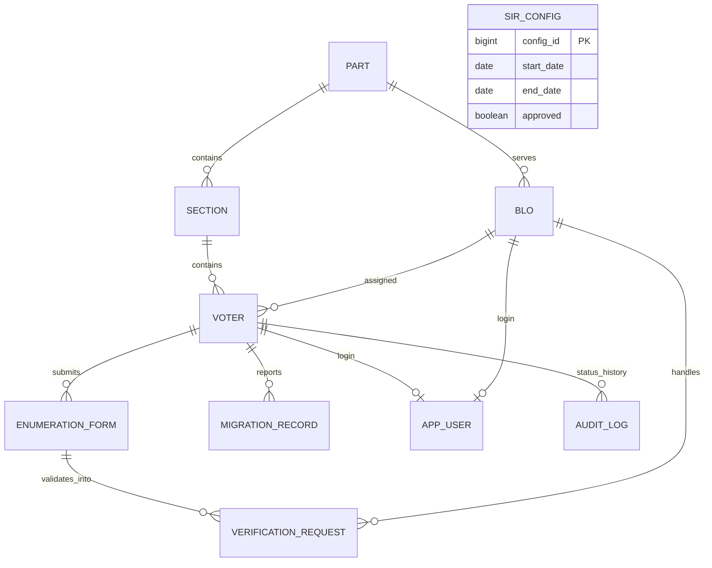

# Design notes

## 1. Problem statement and scope

The SIR Management System tracks voter enumeration, validation, field verification by Booth Level Officers (BLOs), migration reports, approved electoral-roll updates, and administrative summaries. The application models one electoral part and can be extended to additional parts. It supplies the workflow and schema; an operator must load an anonymized roll for demonstrations.

## 2. DFD-to-database mapping

| DFD element / flow | Database implementation | Web endpoint |
|---|---|---|
| Voter submits enumeration form; acknowledgement | D2 `enumeration_form`; `fn_submit_form` returns form ID | `POST /voter/form` |
| 2.1 validate form against D1; invalid loops to 1.0 | `fn_validate_form`, `form_status`, `error_reason` | `GET /voter/form/{id}` reports invalid reason; voter can resubmit |
| 2.2 field verification request to BLO | D2 and `verification_request`; `fn_send_verification_request` | Automatic after valid form |
| 2.3 BLO report updates D1 and sends verified data onward | `fn_record_verification`, `voter.status`, `audit_log` | `POST /blo/verification/{id}` |
| 3.0 booth allocation and assigned list to BLO | D3 `part`, `section`, `blo`, voter assignment; `fn_assign_booth_and_blo`, `v_blo_assigned_voters` | BLO dashboard |
| 4.0 voter migration to D4 | `migration_record`; `fn_record_migration` | `POST /voter/migration` |
| 5.0 approved SIR configuration applies migration and verified data | `sir_config`, `fn_apply_roll_update` in caller transaction; D1 voter updates | Admin config and apply endpoints |
| 6.0 reports to Administrator | `part_summary`, `section_summary`, `status_summary`, `pending_by_blo` | Admin dashboard and `/admin/report.csv` |
| D1 voter records | `voter`, linked `part`, `section`, `blo` | Voter/BLO/admin dashboards |
| D2 forms | `enumeration_form`, `verification_request` | Voter submission and BLO workflow |
| D3 Booth & BLO records | `part`, `section`, `blo`, `voter.assigned_blo_id` | BLO assignment view |
| D4 Migration records | `migration_record` | Voter migration form |
| Voter/BLO/Admin identities | `app_user` with role and linked identity | Session-backed role dashboard |

## 3. ER diagram

## 4. Relational schema and normalization

`part(part_no → assembly_constituency,name)`, `section((part_no,section_no) → section_name)`, `blo(blo_id → username,full_name,part_no)`, `voter(epic → part_no,section_no,serial_no,name,relation_type,relation_name,house_no,age,gender,status,assigned_blo_id)`, `enumeration_form(form_id → epic,payload,status,...)`, `verification_request(request_id → form_id,epic,blo_id,status,...)`, `migration_record(migration_id → epic,from_address,to_address,...)`, and the supporting configuration/user/audit relations. EPIC is the voter key; `(part_no,serial_no)` is also unique.

Each attribute is atomic (1NF). Non-key attributes depend on the full key: section names are separated from voter rows, and part and BLO descriptions are held in their own relations (2NF). There are no transitive dependencies among voter attributes because part, section, and BLO details are referenced by keys rather than repeated (3NF). House number remains on the voter because it is a roll-entry address attribute and no stable house entity/key is provided in the source roll; a separate address entity would be artificial without that key. Enumeration payload is JSONB to retain submitted form fields and future form revisions; its identity, status, and audit lifecycle remain relational.

## 5. Transactions, triggers, roles, indexes

PostgreSQL functions own workflow mutations. `fn_apply_roll_update` executes its voter and migration-record changes in the transaction of its SQL caller; any exception rolls the whole call back. It checks an approved configuration whose inclusive date range contains `current_date`. The trigger captures status transitions in `audit_log`, maintains `updated_at`, and prevents changes to core voter details after migration application. Roles have narrow grants; application sessions additionally enforce VOTER/BLO/ADMIN routing. The schema index set includes part/section, status, and name lookup indexes. `v_blo_assigned_voters` provides the BLO's assigned list.

## 6. Test results and screenshots

`tests/test_etl.py` validates the expected row/gender/serial/EPIC contract using synthetic fixtures. `tests/test_database_workflow.py` is an opt-in PostgreSQL integration test for valid/invalid forms, audit triggers, and the no-approved-window rejection. Set `TEST_DATABASE_URL` to a disposable database. UI screenshots can be captured after starting the app and signing in with seed accounts. The repository does not claim a database test result until run against PostgreSQL.

## 7. Limitations and future work

PDF card layout and OCR quality vary by scan; extraction is deliberately fail-closed and the initial parser should be reviewed against source output before import. The DFD source PDF was not included in the workspace; this mapping uses the supplied textual process description. Add CSRF protection, account provisioning/reset, production secret management, request-level audit attribution, voter OTP/identity proofing, configurable booth/part allocation, and stronger address and field validation before production. The bundled demo seed uses fixed credentials and is for local coursework only.

### Query-plan exercise

For an index comparison on real and scaled data, load the anonymized roll and generate synthetic rows into a disposable copy with `generate_series(1,100000)`. Run `EXPLAIN (ANALYZE, BUFFERS) SELECT * FROM voter WHERE name='...'` before and after `CREATE INDEX ... ON voter(name)` (drop that index for the first measurement). Record planner output and timings in the report; on 494 rows PostgreSQL may correctly prefer a sequential scan, so use the scaled dataset to show index selection. No timings are fabricated here.
