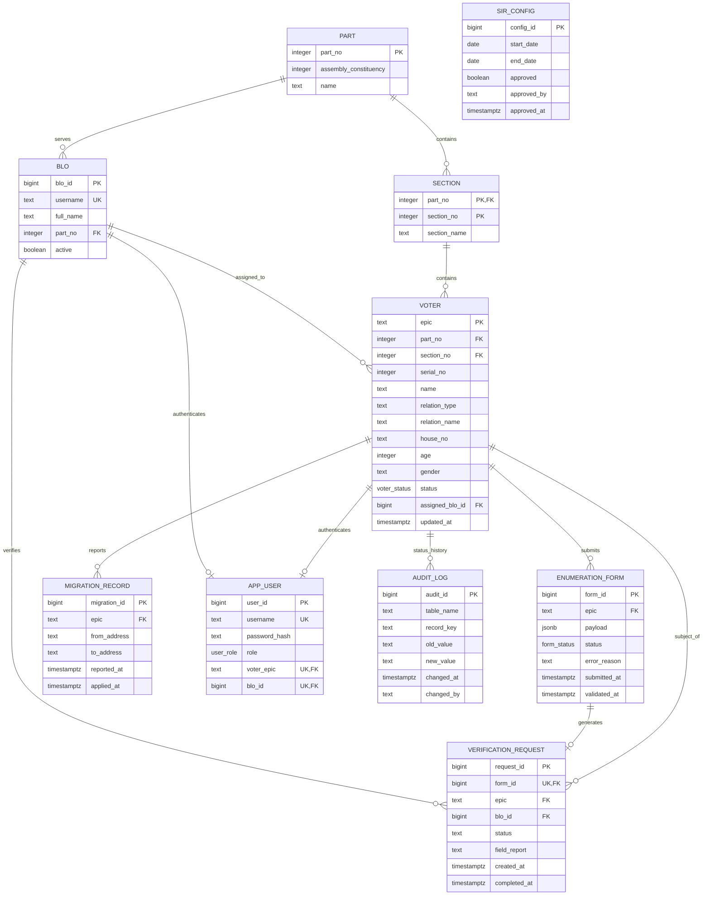

# SIR Management System — Database & System Design

## 1. Problem Statement and Scope

The **SIR (Special Intensive Revision) Management System** models the electoral-roll revision lifecycle specified in the supplied Level 0, Level 1, and Level 2 Data Flow Diagrams (DFDs): voter enumeration form submission and validation, Booth Level Officer (BLO) field verification, booth/BLO allocation, voter migration reporting, administrator-approved electoral-roll updates, and summary reporting.

The project is scoped for a third-year engineering DBMS course: clear PostgreSQL schema and PL/pgSQL logic, visible parameterized SQL through `psycopg`, a simple FastAPI + Jinja2 web UI, focused `pytest` verification, and local setup without containerization or heavy frameworks.

---

## 2. DFD-to-Implementation Mapping

### 2.1 External Entities (Level 0 & Level 1)

| DFD Entity | Database Representation | Application Interface |
|---|---|---|
| **Voter** | `app_user(role='VOTER', voter_epic)` linked to `voter` | Login (`/login`), Voter Dashboard (`/dashboard`), public status lookup (`/voter/status`) |
| **BLO (Booth Level Officer)** | `app_user(role='BLO', blo_id)` linked to `blo` | Login (`/login`), BLO Dashboard (`/dashboard`) |
| **SIR Administrator** | `app_user(role='ADMIN')` | Login (`/login`), Administrator Dashboard (`/dashboard`) |

### 2.2 Data Stores (Level 1 & Level 2)

| DFD Store | PostgreSQL Tables | Purpose |
|---|---|---|
| **D1 — Voter Records** | `voter` (with `audit_log` for status transitions) | Master electoral roll keyed by `epic`, plus `status`, `assigned_blo_id`, and `updated_at` |
| **D2 — Enumeration Forms** | `enumeration_form`, `verification_request` | Submitted enumeration payloads, validation status/reason, and BLO verification requests |
| **D3 — Booth & BLO Records** | `part`, `section`, `blo`, `voter.assigned_blo_id` | Polling booth/part metadata, sections, registered BLOs, and booth-to-BLO assignments |
| **D4 — Migration Records** | `migration_record` | Voter-reported address migrations and roll-application timestamp (`applied_at`) |
| *Supporting tables* | `sir_config`, `app_user`, `audit_log` | SIR approval windows (Process 5.0), hashed credentials/roles, and audit trail |

### 2.3 Processes and Data Flows (Level 1 & Level 2)

| DFD Process | Key Data Flows | Database Implementation | Web Endpoint |
|---|---|---|---|
| **1.0 Receive Enumeration Form** | Voter → *Enumeration Form, Personal Details* → 1.0 → *Form Data* (D2), *Acknowledgement* (Voter), *Submitted Form* (2.0) | `fn_submit_form(p_epic, p_payload)` inserts into `enumeration_form` and returns `form_id` | `POST /voter/form` |
| **2.1 Validate Enumeration Form** | *Submitted Form* (1.0) + *Existing Records* (D1) → 2.1 → *Valid Form Details* (2.2) or *Invalid Form* (loops back to 1.0) | `fn_validate_form(p_form)` checks voter existence, post-migration lock, non-empty name, and age `18..120` (idempotent once validated); sets `status` (`VALID`/`INVALID`) and `error_reason` | `POST /voter/form` (result shown on read-only `GET /voter/form/{form_id}`) |
| **2.2 Send Field Verification Request** | *Valid Form Details* (2.1) → 2.2 → *Verification Request* (BLO) ← *Verification Results, Field Reports* (BLO) → *Verification Outcome* (2.3) | `fn_send_verification_request(p_form)` creates `verification_request` for the voter's `assigned_blo_id` | Automatic on valid form in `POST /voter/form`; displayed on BLO `/dashboard` |
| **2.3 Update Verification Status** | *Verification Outcome* (2.2) → 2.3 → *Verification Record / Verified Details* (D1) & *Verified Voter Data* (3.0) | `fn_record_verification(p_request, p_ok, p_report)` closes the request, updates `voter` details/status (`VERIFIED` or `REJECTED`), and triggers `audit_log` | `POST /blo/verification/{request_id}` |
| **3.0 Manage Booth Allocation** | *Verified Voter Data* (2.0) + *Booth Info* (D3) → 3.0 → *Booth Assignment* (D3) & *Assigned Voter List, Booth Details* (BLO) | `fn_assign_booth_and_blo(p_part, p_blo)` updates `voter.assigned_blo_id`; `v_blo_assigned_voters` exposes assigned voters + booth/section details | `POST /admin/assign`; BLO `/dashboard` |
| **4.0 Record Migration** | Voter → *Migration Info* → 4.0 → *Migration Record* (D4) & *Migration Update* (5.0) | `fn_record_migration(p_epic, p_from, p_to)` inserts into `migration_record` (max one open migration per voter via partial unique index) | `POST /voter/migration` |
| **5.0 Update Electoral Roll** | *Migration Update* (4.0) + *Voter Records* (D1) + *SIR Configuration, Approval* (Admin) → 5.0 → *Updated Records* (D1), *Verification Status / Voter Status* (Voter), *Updated Roll Data* (6.0) | `sir_config` stores approved date windows; `fn_apply_roll_update()` atomically updates `VERIFIED` voters with open migrations to `MIGRATED` and stamps `applied_at` | `POST /admin/config`, `POST /admin/apply`, `GET /voter/status`, Voter `/dashboard` |
| **6.0 Generate SIR Reports** | *Updated Roll Data* (5.0) + *Booth Statistics* (D3) → 6.0 → *Reports, Statistics* (Admin) | Views `part_summary`, `section_summary`, `status_summary`, `pending_by_blo` | Admin `/dashboard`, `GET /admin/report.csv` |

---

## 3. Entity-Relationship (ER) Diagram

---

## 4. Relational Schema & Normalization

- **1NF (Atomic attributes):** Every column holds a single atomic value (gender is `'M'|'F'|'T'`, relation type and name are separate columns, addresses are trimmed strings). The only semi-structured field is `enumeration_form.payload` (`jsonb`), used intentionally to preserve raw submitted form snapshots across future form revisions while keeping identity, foreign keys, status, and timestamps relational.
- **2NF (No partial dependencies):** In `section(part_no, section_no) -> section_name`, `section_name` depends on the full composite key `(part_no, section_no)`. Part-level attributes (`assembly_constituency`, `part.name`) are separated into `part(part_no)` rather than repeated on every `section` or `voter` row.
- **3NF (No transitive dependencies):** `voter(epic)` references `section(part_no, section_no)` and `blo(blo_id)` by foreign keys instead of duplicating booth names, section names, or BLO names. `house_no` stays on `voter` because the source electoral roll provides no separate house entity or key.

---

## 5. Transactions, Triggers, Roles, and Indexes

### Transactions & Rollback
- All multi-step workflows (`fn_record_verification`, `fn_apply_roll_update`, and `etl/load_roll.py`) run inside PostgreSQL transactions via `psycopg`'s connection context manager (`with psycopg.connect(...) as conn:`).
- `fn_apply_roll_update()` verifies an approved `sir_config` covering `current_date` and uses a single atomic CTE to update `voter` (`house_no`, `status = 'MIGRATED'`) and stamp `migration_record.applied_at = now()`. Any exception (such as a missing approved SIR window or a trigger violation) aborts and rolls back the entire transaction.

### Triggers
- `voter_touch` (`BEFORE UPDATE ON voter`): automatically refreshes `voter.updated_at = now()`.
- `voter_status_audit` (`AFTER UPDATE ON voter`): records every `voter.status` transition in `audit_log`.
- `voter_migration_guard` (`BEFORE UPDATE ON voter`): blocks edits to core roll/demographic fields (`part_no`, `section_no`, `serial_no`, `name`, `relation_type`, `relation_name`, `house_no`, `age`, `gender`) and `status` once a voter has an applied migration.

### Database Roles & Coursework Limits
- `db/schema.sql` defines three `NOLOGIN` roles (`voter_role`, `blo_role`, `admin_role`) with least-privilege table, sequence, and function grants after revoking `PUBLIC` access.
- **Coursework limit:** The FastAPI web app connects using a single application database user (`DATABASE_URL`, e.g. `sir`) and enforces `VOTER` / `BLO` / `ADMIN` boundaries in session middleware plus ownership checks (e.g., voters can only view their own forms; BLOs can only act on requests assigned to their `blo_id`). True per-user database impersonation (`SET LOCAL ROLE` + Row-Level Security policies) is demonstrated at the SQL role level in tests rather than wired into connection pooling.

### Indexes
- Primary keys and unique constraints (`voter(epic)`, `voter(part_no, serial_no)`, `verification_request(form_id)`, partial unique index `uq_one_open_migration_per_voter`).
- Lookup indexes: `idx_voter_part_section`, `idx_voter_status`, `idx_voter_name`, `idx_voter_assigned_blo`, `idx_enumeration_form_epic`, `idx_verification_blo_status`, `idx_audit_log_record`.
- `db/performance.sql` provides a reproducible `EXPLAIN (ANALYZE, BUFFERS)` exercise comparing sequential scan vs. B-tree index scan on 100,000 synthetic rows inside a rolled-back transaction (since PostgreSQL may prefer a sequential scan on only 494 rows).

---

## 6. Test Results & Verification Status

### What ran and passed
- `python etl/extract_roll.py .\2026-EROLLGEN-S10-174-SIR-DraftRoll-Revision1-ENG-271-WI.pdf`: **Passed** (`Validated 494 voters (M=254, F=239, T=1); wrote data\extracted\voters.csv`) using `pdfplumber`/`pypdfium2` native rendering + border-free Tesseract OCR.
- `python etl/anonymize.py data/extracted/voters.csv data/anonymized/voters.csv`: **Passed** (`Anonymized 494 rows -> data\anonymized\voters.csv`), replacing PII while preserving counts, ages, genders, serials, and sections.
- `pytest -v`: **12 passed, 4 skipped** — all ETL validation, card parsing, anonymization, and web auth/role tests passed.

### What could not be verified in the current environment
- **PostgreSQL integration tests (`tests/test_database_workflow.py` marked `@dbtest`), `etl/load_roll.py`, `seed.py`, and `demo.sql`:** Skipped because PostgreSQL (`psql` / server) is not installed in the verification environment (`TEST_DATABASE_URL` unset). Run them locally after installing PostgreSQL 15+ using the commands in [README.md](../README.md).

---

## 7. Limitations & Future Improvements

- **OCR accuracy on scanned rolls:** Scan quality and column alignment vary across electoral-roll PDFs; `etl/extract_roll.py` intentionally fails closed if any count, serial, or EPIC check fails so bad OCR output is never silently imported.
- **Security hardening for production:** Add CSRF tokens on HTML forms, PostgreSQL Row-Level Security (RLS) paired with `SET LOCAL ROLE`, password reset / account provisioning flows, and externalized session secrets.
- **Multi-part scaling:** The schema supports multiple `part` rows, while `etl/load_roll.py` currently loads one part per invocation (configured via `PART_NO`, `ASSEMBLY_CONSTITUENCY`, and `PART_NAME`).
